# `login-password-totp-403.saz` 链路对照

## 结论

403 是账号被封后的预期结果，不作为链路故障分析。重点对照后，结论是：**密码验证、MFA challenge、TOTP verify 这几步的端点和 JSON 字段语义，与仓库实现基本一致；整个前置流程、请求头和 JSON 原始序列化并非逐项一致。**

## 主链顺序

```mermaid
flowchart LR
    A["#11 登录页入口"] --> B["#15 providers"]
    B --> C["#16 CSRF"]
    C --> D["#17 signin/openai"]
    D --> E["#18 OAuth authorize"]
    E --> F["#19 密码页"]
    F --> G["#34 Sentinel password_verify"]
    G --> H["#58 password/verify：返回 MFA challenge"]
    H --> I["#84 mfa/issue_challenge"]
    I --> J["#87 Sentinel verify_mfa"]
    J --> K["#93 mfa/verify"]
```

- 前置请求中，#1–10 是 mweb 遥测和 handoff 等辅助流量；#49–56 有 CES/AB 等辅助请求。
- #16 返回的 CSRF 值与 #17 表单中的值相同；#17 响应中的 authorize URL 与 #18 请求 URL 相同。
- #34 的 Sentinel token 与 #58 请求头中的 token 内容匹配；#87 与 #93 也匹配。#89、#98 虽然发送了 Sentinel 请求，但在本 SAZ 中没有找到 token 内容匹配的消费者，不能把它们算作额外的密码或 TOTP 提交。
- #58 返回的 MFA factor ID 与 #84、#93 请求体中的 ID 一致。

## 报文对照

| 请求 | 位置/字段 | HAR 值或来源证据 | 本地构造来源 | 判断 |
|---|---|---|---|---|
| #11、#17 | 登录提示及会话参数 | #11 的 `auth/login_with` query 含 `callback_path`、`screen_hint`、`login_hint`、`auth_session_logging_id`、`ext-oai-did`；#17 signin query 重传登录上下文 | `chatgpt_auth.py:21-29, 150-157` 构造相同的登录上下文字段 | 字段语义相符；但本地查活入口是 `/auth/login`，SAZ 实际入口是 `/auth/login_with` |
| #15、#16 | Referer、GET 头 | Referer 是带 query 的 `/auth/login_with`；GET 未见 `Content-Type`、`Priority` | `get_providers`、`get_csrf_token` 默认 Referer 为 `/auth/login`；`get_nextauth_headers` 构造 `Content-Type: application/json` 和 `Priority: u=1, i`（`chatgpt_auth.py:56-80, 88-110`；`session.py:652-664`） | **不完全一致**：Referer 不同；构造层多出两个 HAR 未记录的头 |
| #16 → #17 | CSRF | 响应中的 `csrfToken` 与 #17 form body 中的值相同 | `signin_openai` 把取到的 token 编码进表单（`chatgpt_auth.py:168-175`） | 传递一致 |
| #17 | signin query/body | body 字段是 `callbackUrl`、`csrfToken`、`json`；query 字段和值与本地相同 | `signin_openai` 使用 `urlencode`；本地 query 的字段顺序与 HAR 不同 | 字段和值一致；query 顺序不完全一致 |
| #18 | OAuth authorize query | #17 返回的 URL 与 #18 请求完全相同；scope、client、redirect、audience、设备及登录上下文字段均在 URL 中 | 固定 OAuth 参数在 `config/openai_protocol.py:11-25`；`_ensure_authorize_context` 补设备和登录上下文并保留原参数（`chatgpt_auth.py:32-53`） | 链接传递一致；`state` / PKCE 是此次授权生成的动态值，本地代码保留它们，不自行生成 |
| #34、#87 | Sentinel body | JSON 字段为 `p`、`id`、`flow`；分别对应 `password_verify`、`verify_mfa` | `build_sentinel_request_body` 构造这三个字段；`request_sentinel_token` 传入当前 flow（`sentinel.py:259-276`；`openai_auth.py:409-427`） | **body 结构一致**；动态 `p` 内容与画像有关 |
| #58 | password body | 只有 `password` 字段 | `verify_login_password` 发送 `{"password": ...}`（`openai_auth.py:1025-1042`） | JSON 字段语义一致；HAR 是紧凑 JSON，本地 `json.dumps` 默认会在分隔符后加空格，原始 body 字节不完全一致 |
| #84 | issue challenge body | `id`、`type: totp`、`force_fresh_challenge: false` | `_mfa_issue_challenge` 构造同样字段和值（`openai_auth.py:987-996`） | 字段和值一致；同样存在 JSON 空白差异 |
| #93 | verify body | `id`、`type: totp`、`code` | `_mfa_verify` 构造同样字段和值（`openai_auth.py:1004-1017`） | 字段语义一致；同样存在 JSON 空白差异 |

## 请求头差异

| 请求 | 位置/字段 | HAR 值或来源证据 | 本地构造来源 | 判断 |
|---|---|---|---|---|
| #15–19、#34、#58、#84、#87、#93 | UA / Client Hints | HAR 是 Windows Edge/Chromium 157；认证 API 请求带 `sec-ch-ua-full-version`、`full-version-list`、platform version、arch、bitness、model | 当前协议会话固定 `wreq/chrome152`，画像对齐为 macOS Chrome（`session.py:201-205`；`protocol_profiles.py:23-46`）；认证调用默认不发高熵 hints（`session.py:683-717`） | **明显不一致**：浏览器/平台/版本画像不同；高熵头在 HAR 出现、本地默认构造不出现 |
| #34、#87 | Sentinel 请求头 | HAR 有低熵 Client Hints、`Accept-Language`、`Origin`、`Referer`、Fetch Metadata；未见 `Priority` | `get_sentinel_headers` 构造这些头并加 `Priority: u=1, i`（`session.py:754-773`） | 主字段形态相符；`Priority` 是构造层差异 |
| #15–17、#58、#84、#93 | `Priority` | HAR 未记录该头 | NextAuth / Auth JSON 头构造器会设置 `Priority: u=1, i` | **不一致** |
| #15–16 | `Content-Type` | HAR 的 GET 未记录该头 | `get_nextauth_headers` 会设置 `application/json` | **不一致** |
| #18 | 导航头 | HAR 有导航 Fetch Metadata、Referer 和 `upgrade-insecure-requests`；未见 `Priority`、`Sec-Fetch-User` | `follow_authorize` 调用 `get_auth_navigate_headers`；默认设置 `Priority: u=0, i` 和 `Sec-Fetch-User: ?1`（`openai_auth.py:345-362`；`session.py:719-735`） | 主要导航头相符，至少这两个字段在 HAR 中未记录 |
| #58、#84、#93 | Auth trace / navigation IDs | 同一 document-navigation ID；每次请求的 invocation ID 不同，trace/RUM 字段存在 | `_attach_auth_rum_headers` 复用 navigation ID、每次生成 invocation ID 并附加 trace（`session.py:590-599`） | 字段和跨请求模式相符；动态 ID 不作字节值比较 |
| #15–19、#34、#58、#84、#87、#93 | `Accept-Language` | HAR 有该头，值为中文优先的语言列表 | 本地从 `browser_profile.accept_language` 取值（`session.py:529-555`） | 字段来源类型一致；没有本次运行的画像，不能确认本地实际值相同 |

另一个 body 内部差异：#34 的 `p` 解码后含 Windows Edge 157 UA、screen sum `3000`、`hardwareConcurrency=20`；而本地协议画像会对齐 Chrome 152/macOS，当前画像池的 CPU 值为 6/8/10/12。`p` 外层字段结构一致，但其中的指纹值**并不等同于当前代码默认/画像池样本**。该值差异不改变本次流程的字段传递关系。

## 流程层差异

本地查活流程在 `account_liveness.py:126-152, 187-191` 中是 `/auth/login` 导航、anonymous bootstrap、providers、`/api/auth/session`、CSRF、再次读取 session、signin；这份 SAZ 则从 `/auth/login_with` 开始，捕获中**未见 `/api/auth/session`**。因此它们不是逐请求完全相同的脚本流程；从 signin / authorize 到密码与 MFA API 的字段语义更接近，主链报文形状基本对应。

以上差异是捕获与当前代码构造规则的对照，不据此判断它们导致了 #93 的账号状态响应。SAZ 中的 Cookie、凭据和动态 ID 均未复述。
